# 留存因子终局绩效分析报告

- 因子值与前瞻 label 均由 vnpy.alpha（AlphaDataset 表达式引擎）计算
- 股票池：沪深300 成分股日线 859 只；label = T+1→T+3 收益
- 分组：每日按因子值 10 分组（qcut）；多空 = Q10 均值 − Q1 均值；年化按 244 交易日

## 因子总览

| 因子 | train RankIR | valid RankIR | test RankIR | test 多空 Sharpe |
|---|---|---|---|---|
| REV4_TURN_HIGHPOS（4日反转×换手×高位权重） | +0.49 | +0.28 | +0.00 | 0.91 |
| REV4_TURN（4日反转×换手，简形式） | +0.40 | +0.24 | +0.00 | 0.87 |
| REV4_TURN_POS20_AMP（四件套：反转×换手×高位×振幅） | +0.49 | +0.31 | +0.00 | 0.65 |

test 段为三个因子的共同样本外确认区间，多空净值对比如下：

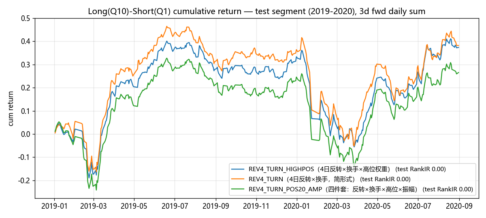

## REV4_TURN_HIGHPOS（4日反转×换手×高位权重）（rev4_turn_highpos）

表达式：-ts_delta(close, 4) / close * cs_rank(turnover) * ((close - ts_min(close, 20)) / (ts_max(close, 20) - ts_min(close, 20)))

### 分段 IC 指标

| 段 | 天数 | IC | IR | RankIC | RankIR | 方向胜率 |
|---|---|---|---|---|---|---|
| train | 2190 | +0.0401 | +0.312 | +0.0667 | +0.486 | 69.50% |
| valid | 487 | +0.0115 | +0.090 | +0.0375 | +0.284 | 63.45% |
| test | 405 | +0.0042 | +0.032 | +0.0196 | +0.154 | 53.83% |

### 全样本分组与多空表现

| 指标 | 数值 |
|---|---|
| 分组平均日收益 Q1→Q10 | -0.08% / -0.03% / +0.03% / +0.05% / +0.09% / +0.10% / +0.13% / +0.16% / +0.19% / +0.22% |
| 单调性（Q 序号 Spearman） | +1.00 |
| 多空年化收益 | +73.33% |
| 多空年化波动 | +26.03% |
| 多空 Sharpe | 2.82 |
| 多空最大回撤 | -37.97% |
| 多头(Q10)年化 | +53.38% |
| 多头组日均换手率 | 67.7% |

> 成本提示：多头组日均换手 67.7%，按单边 0.1%、双边每日调仓估算，年化拖累约 +33.05%，扣除后多空年化约 +40.28%。IC 类指标 ≠ 扣费后组合收益。

### 分段多空表现

| 段 | 多空年化 | 多空波动 | 多空 Sharpe | 最大回撤 | 多头(Q10)年化 | 多头组换手 |
|---|---|---|---|---|---|---|
| train | +104.11% | +27.13% | 3.84 | -33.90% | +70.99% | 69.0% |
| valid | +41.30% | +20.39% | 2.03 | -16.40% | +15.55% | 66.9% |
| test | +22.51% | +24.85% | 0.91 | -37.97% | +93.42% | 67.1% |

### 分年 RankIC

| 年份 | RankIC |
|---|---|
| 2007 | +0.0853 |
| 2008 | +0.0567 |
| 2009 | +0.0841 |
| 2010 | +0.0855 |
| 2011 | +0.0542 |
| 2012 | +0.0661 |
| 2013 | +0.0664 |
| 2014 | +0.0604 |
| 2015 | +0.0678 |
| 2016 | +0.0599 |
| 2017 | +0.0458 |
| 2018 | +0.0291 |
| 2019 | +0.0216 |
| 2020 | +0.0136 |
| 2021 | +0.0224 |
| 2022 | +0.0228 |
| 2023 | -0.0037 |
| 2024 | -0.1024 |

**16/18 年 RankIC 为正**

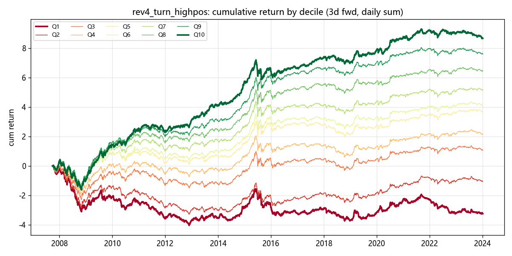

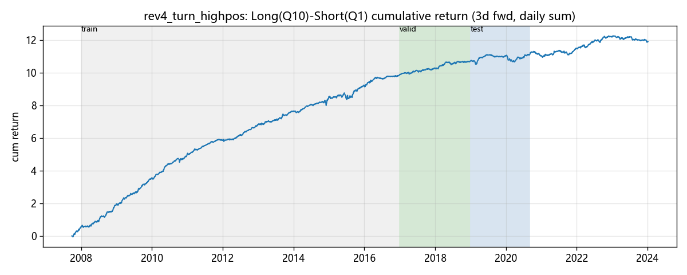

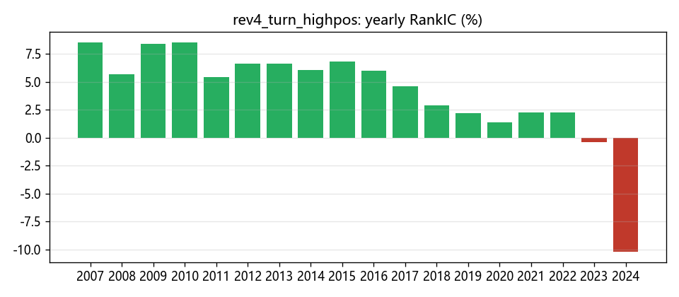

## REV4_TURN（4日反转×换手，简形式）（rev4_turn）

表达式：-ts_delta(close, 4) / close * cs_rank(turnover)

### 分段 IC 指标

| 段 | 天数 | IC | IR | RankIC | RankIR | 方向胜率 |
|---|---|---|---|---|---|---|
| train | 2190 | +0.0378 | +0.260 | +0.0653 | +0.399 | 65.75% |
| valid | 487 | +0.0131 | +0.094 | +0.0375 | +0.239 | 60.57% |
| test | 405 | +0.0063 | +0.046 | +0.0247 | +0.170 | 54.57% |

### 全样本分组与多空表现

| 指标 | 数值 |
|---|---|
| 分组平均日收益 Q1→Q10 | -0.10% / -0.01% / +0.03% / +0.08% / +0.11% / +0.12% / +0.15% / +0.20% / +0.20% / +0.17% |
| 单调性（Q 序号 Spearman） | +0.96 |
| 多空年化收益 | +66.73% |
| 多空年化波动 | +31.12% |
| 多空 Sharpe | 2.14 |
| 多空最大回撤 | -47.79% |
| 多头(Q10)年化 | +41.29% |
| 多头组日均换手率 | 61.3% |

> 成本提示：多头组日均换手 61.3%，按单边 0.1%、双边每日调仓估算，年化拖累约 +29.90%，扣除后多空年化约 +36.83%。IC 类指标 ≠ 扣费后组合收益。

### 分段多空表现

| 段 | 多空年化 | 多空波动 | 多空 Sharpe | 最大回撤 | 多头(Q10)年化 | 多头组换手 |
|---|---|---|---|---|---|---|
| train | +94.82% | +33.40% | 2.84 | -47.79% | +55.07% | 62.5% |
| valid | +27.89% | +24.79% | 1.13 | -23.11% | -6.40% | 59.6% |
| test | +23.02% | +26.49% | 0.87 | -41.72% | +88.27% | 62.1% |

### 分年 RankIC

| 年份 | RankIC |
|---|---|
| 2007 | +0.0908 |
| 2008 | +0.0527 |
| 2009 | +0.0825 |
| 2010 | +0.0751 |
| 2011 | +0.0520 |
| 2012 | +0.0591 |
| 2013 | +0.0715 |
| 2014 | +0.0675 |
| 2015 | +0.0716 |
| 2016 | +0.0562 |
| 2017 | +0.0434 |
| 2018 | +0.0316 |
| 2019 | +0.0295 |
| 2020 | +0.0201 |
| 2021 | +0.0161 |
| 2022 | +0.0269 |
| 2023 | -0.0104 |
| 2024 | -0.0689 |

**16/18 年 RankIC 为正**

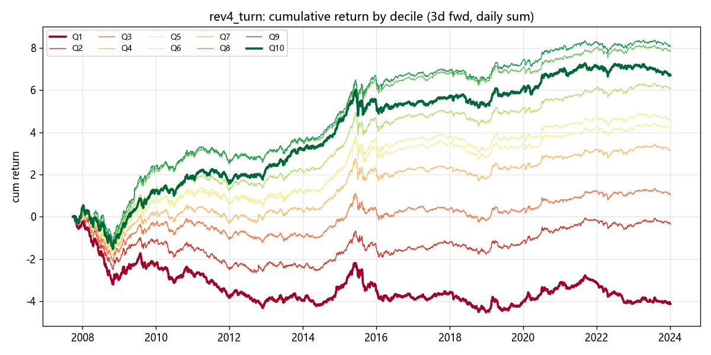

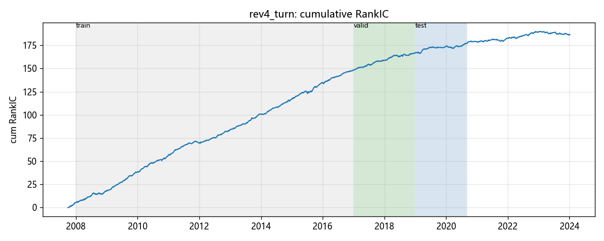

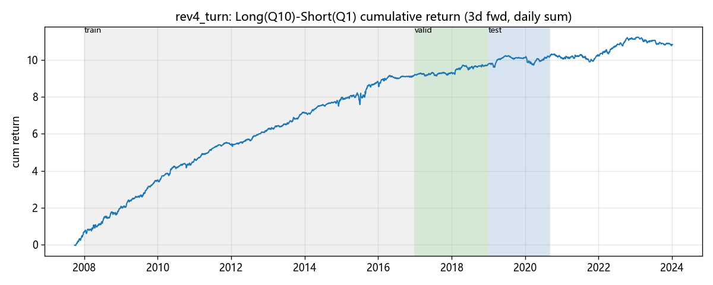

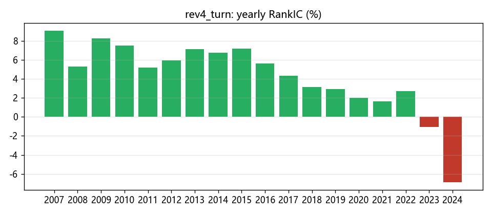

## REV4_TURN_POS20_AMP（四件套：反转×换手×高位×振幅）（rev4_turn_pos20_amp）

表达式：-ts_delta(close, 4) / close * cs_rank(turnover) * ((close - ts_min(close, 20)) / (ts_max(close, 20) - ts_min(close, 20))) * cs_rank(ts_mean((high - low) / close, 20))

### 分段 IC 指标

| 段 | 天数 | IC | IR | RankIC | RankIR | 方向胜率 |
|---|---|---|---|---|---|---|
| train | 2190 | +0.0403 | +0.316 | +0.0692 | +0.491 | 69.50% |
| valid | 487 | +0.0175 | +0.138 | +0.0414 | +0.309 | 64.07% |
| test | 405 | +0.0044 | +0.033 | +0.0206 | +0.156 | 54.32% |

### 全样本分组与多空表现

| 指标 | 数值 |
|---|---|
| 分组平均日收益 Q1→Q10 | -0.10% / -0.04% / +0.01% / +0.06% / +0.11% / +0.12% / +0.13% / +0.15% / +0.20% / +0.22% |
| 单调性（Q 序号 Spearman） | +1.00 |
| 多空年化收益 | +79.17% |
| 多空年化波动 | +26.36% |
| 多空 Sharpe | 3.00 |
| 多空最大回撤 | -38.61% |
| 多头(Q10)年化 | +53.74% |
| 多头组日均换手率 | 66.0% |

> 成本提示：多头组日均换手 66.0%，按单边 0.1%、双边每日调仓估算，年化拖累约 +32.21%，扣除后多空年化约 +46.96%。IC 类指标 ≠ 扣费后组合收益。

### 分段多空表现

| 段 | 多空年化 | 多空波动 | 多空 Sharpe | 最大回撤 | 多头(Q10)年化 | 多头组换手 |
|---|---|---|---|---|---|---|
| train | +112.52% | +27.53% | 4.09 | -33.44% | +72.79% | 67.3% |
| valid | +49.81% | +20.90% | 2.38 | -14.70% | +12.44% | 65.5% |
| test | +16.00% | +24.66% | 0.65 | -38.61% | +92.45% | 65.4% |

### 分年 RankIC

| 年份 | RankIC |
|---|---|
| 2007 | +0.0892 |
| 2008 | +0.0523 |
| 2009 | +0.0869 |
| 2010 | +0.0859 |
| 2011 | +0.0529 |
| 2012 | +0.0718 |
| 2013 | +0.0724 |
| 2014 | +0.0667 |
| 2015 | +0.0695 |
| 2016 | +0.0649 |
| 2017 | +0.0477 |
| 2018 | +0.0350 |
| 2019 | +0.0245 |
| 2020 | +0.0137 |
| 2021 | +0.0218 |
| 2022 | +0.0235 |
| 2023 | +0.0009 |
| 2024 | -0.0247 |

**17/18 年 RankIC 为正**

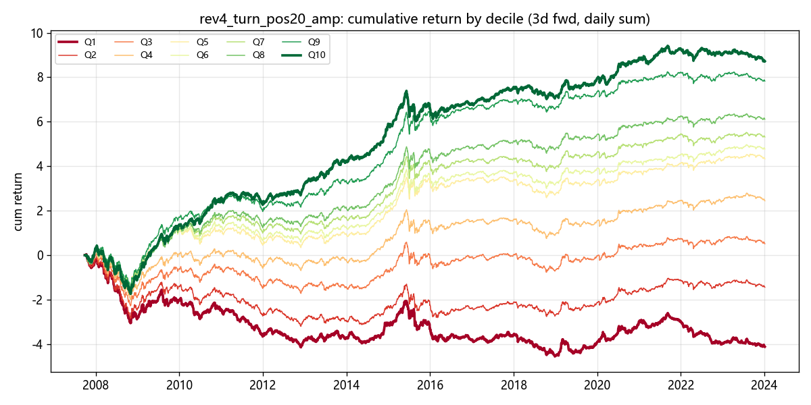

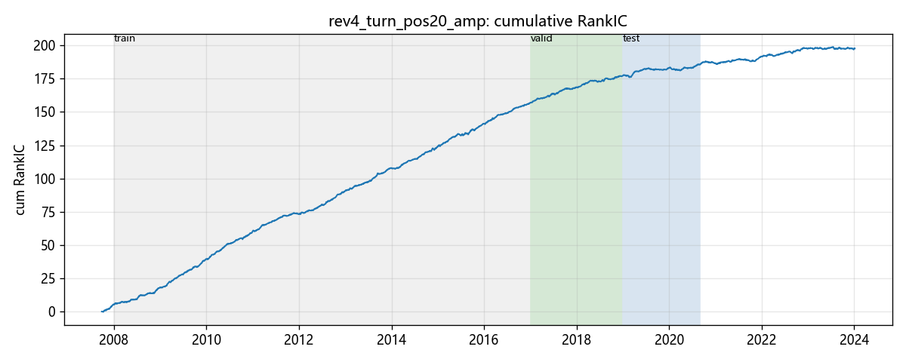

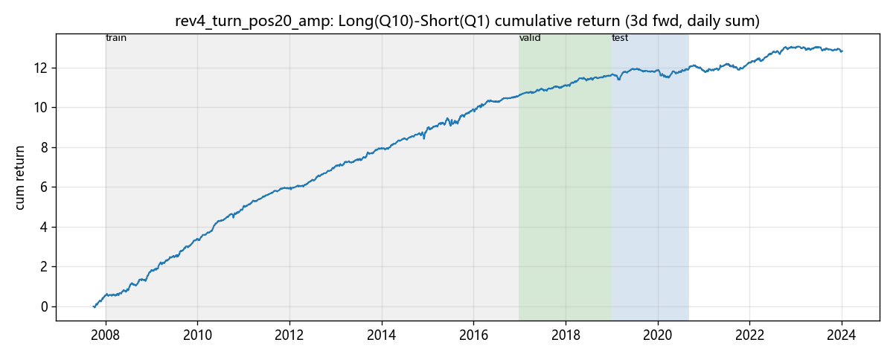

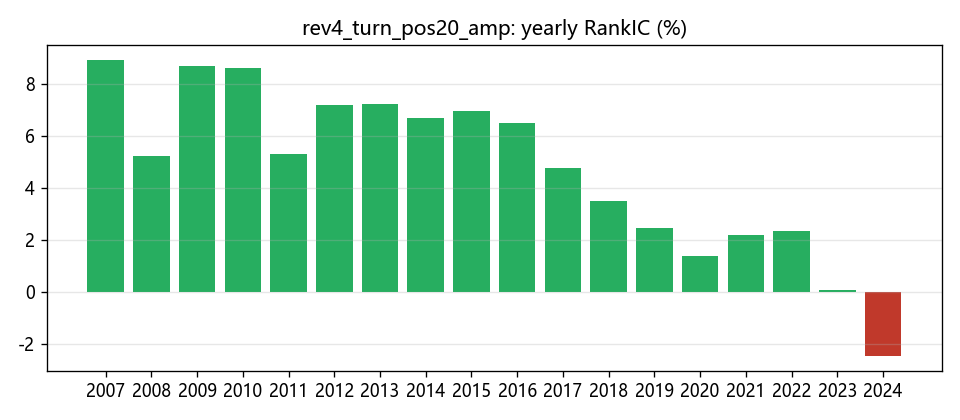
